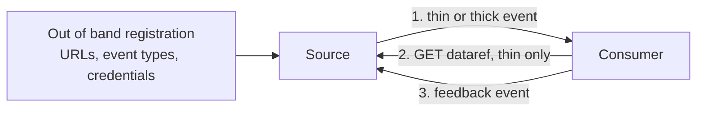

# Which protocol will be used to communicate CloudEvent OEAPI messages?

## Status: Draft

## Context

The Open Education API is initially designed as an OpenAPI (REST) protocol, using synchronous requests from clients to server to retrieve information from an educational institution. However, there are also valid use cases for asynchronous communication, where changes in data are actively pushed towards the client / consumer.

It has been decided that these messages will be communicated by use of CloudEvents. The specifications of these CloudEvents messages [are documented separately](0007-attachments/cloudevents-doc.md). The same goes for the [feedback mechanism](0007-attachments/feedback-doc.md) and for [delivery and registration of endpoints](0007-attachments/delivery-and-registration.md).

CloudEvents are an abstract definition of the metadata of an event, they need to be implemented in a particular protocol. This ADR is made to establish in which protocol the CloudEvents will be expressed in the context of OEAPI.

Further requirements are:

* Although we do not support publish/subscribe patterns yet, we may want to grow towards such a model in the future. The protocol should support this or provide an easy migration path.
* Providing the endpoint at the side of the consumer/client where the message can be sent to, is considered to be out of scope of the API contract. This is configured through other means (see [registration](0007-attachments/delivery-and-registration.md#1-what-is-agreed-out-of-band)).
* The specification we choose should support easy code generation and verification.
* **Feedback:** the consumer must be able to report the processing result of an event back to the source. Without it the source only knows that an event was delivered, not whether it was accepted. This makes visible where messages were not accepted, which leads to action points for the source (improve the data, resend the message). The feedback endpoint of the source is also registered out of band. See the [feedback document](0007-attachments/feedback-doc.md).

## What both options have in common

Whatever the choice, on the wire the sender does an HTTP `POST` of an `application/cloudevents+json` document to a URL the receiver registered. The CloudEvents attributes, the thin/thick/feedback event types and the feedback flow are identical. The options differ in the contract format, the tooling, and the growth path. The diagrams in [delivery-and-registration.md](0007-attachments/delivery-and-registration.md) show:

1. the out-of-band registration of endpoints and credentials,
2. the contract layers of both options on top of shared schemas,
3. the runtime flow including retries and feedback (identical for both),
4. the growth path from HTTP webhooks to brokers,
5. the role of an intermediary such as SURFeduhub.

In short:

Example files for both options are next to this ADR: [oeapi-6.0-with-webhooks.yaml](oeapi-6.0-with-webhooks.yaml) and [oeapi-6.0-asyncapi.yaml](oeapi-6.0-asyncapi.yaml). The AsyncAPI file references all schemas from the OpenAPI file, so both share one definition.

## Considered options

### Option 1: OpenAPI With Webhooks

OpenAPI already defines the synchronous REST contract for OEAPI. Webhooks are a native part of OpenAPI 3.1 (the top-level `webhooks` field) that allow a server to *POST* a CloudEvent to a consumer-provided URL when a specific event occurs.

Because CloudEvents already describes the type of entity and the type of operation (updated/deleted), only a small number of webhooks is needed: one for thin events, one for thick events and one for feedback events. Existing definitions of content types (e.g. course or programme) can be reused.

**Advantages:**

* **Single source of truth** - The entire API surface (both request/response and event contracts) is described in one OpenAPI document, simplifying documentation, versioning and governance.
* **Tooling support** - Existing OpenAPI tooling understands the `webhooks` keyword. Support for generating code for webhook receivers differs per generator and needs to be checked.
* **Smooth migration path** - Consumers that only need synchronous calls can ignore the webhook definitions, while future publish/subscribe features can be added by extending the same document.
* **Validation** - The OpenAPI schema can be used to validate the payload of the CloudEvent (`data`) as it is sent, ensuring consistency with the existing resource models.
* **Fits the Edukoppeling contract register** for the webhook part of a contract.

**Disadvantages:**

* **Limited async semantics** - Webhooks are a push-only mechanism; they do not natively support subscription management, message filtering or durable queues. Implementations must handle retries and dead-letter handling manually.
* **Consumer readiness** - The consumer must expose an HTTP endpoint that is reachable by the sender, which may not be feasible for all clients (e.g. mobile apps behind NAT). Additional deployment concerns (TLS, auth) are required.
* **No standard Pub/Sub integration** - While OpenAPI can describe the webhook, it does not provide a native abstraction for broker-based publish/subscribe systems (Kafka, MQTT, etc.).

### Option 2: AsyncAPI

AsyncAPI is a specification purpose-built for event-driven architectures. It describes how CloudEvents are transmitted over a transport protocol (HTTP, AMQP, MQTT, ...) and includes rich metadata for channels, servers, message bindings and security. The example uses AsyncAPI 3.1.

**Advantages:**

* **Designed for async** - Provides first-class concepts such as `servers`, `channels`, `operations` (`send` / `receive`) and message bindings, making it straightforward to model thin, thick and feedback events, including the opposite direction of the feedback.
* **Pub/Sub ready** - Native support for broker-based transports enables a future migration to a full publish/subscribe model by changing the server, not the messages.
* **Code generation** - Tools like the AsyncAPI generator can produce documentation, handlers and client libraries for many languages and protocols.
* **Validation & tooling** - AsyncAPI includes a validator and the payload is described with JSON Schema.
* **Fits the Edukoppeling contract register** for the business data part of a contract.

**Disadvantages:**

* **Double specification** - The existing OEAPI REST contract remains in OpenAPI; adopting AsyncAPI adds a second specification to maintain, potentially causing divergence if changes are not kept in sync. This is limited when the AsyncAPI document references the schemas from the OpenAPI document, as in the example.
* **Tooling maturity** - While AsyncAPI tooling is improving, it is still less mature and less widely adopted in the Go ecosystem compared to OpenAPI generators. AsyncAPI 3.x support differs per tool.
* **Learning curve** - Teams need to become familiar with a new spec format and its tooling, which may increase onboarding time.

## Decision

Not yet taken.

## Consequences

To be completed once the decision is taken. In both cases:

* The thin, thick and feedback events, the feedback flow and the registration of endpoints are as described in the attachments.
* Subscriptions (endpoints, event types, credentials, consumer and versions) are agreed out of band and are not part of the contract.

If Option 1 is chosen:

* The OpenAPI definition for OEAPI will be extended with a `webhooks` section describing the event types, version-controlled alongside the existing REST paths.
* Existing CI pipelines that validate OpenAPI documents will validate the webhook definitions as well.
* Documentation tooling needs to show `webhooks` next to the REST endpoints (to be checked for the tooling in use).

If Option 2 is chosen:

* A separate AsyncAPI document is maintained in the specification repository and references the shared schemas.
* CI needs an additional validation step for the AsyncAPI document.
