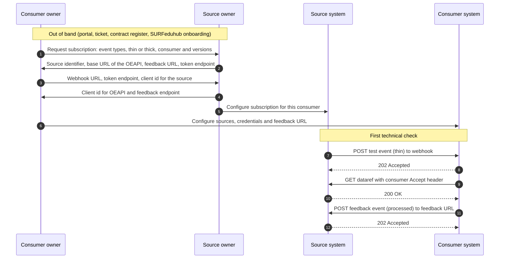
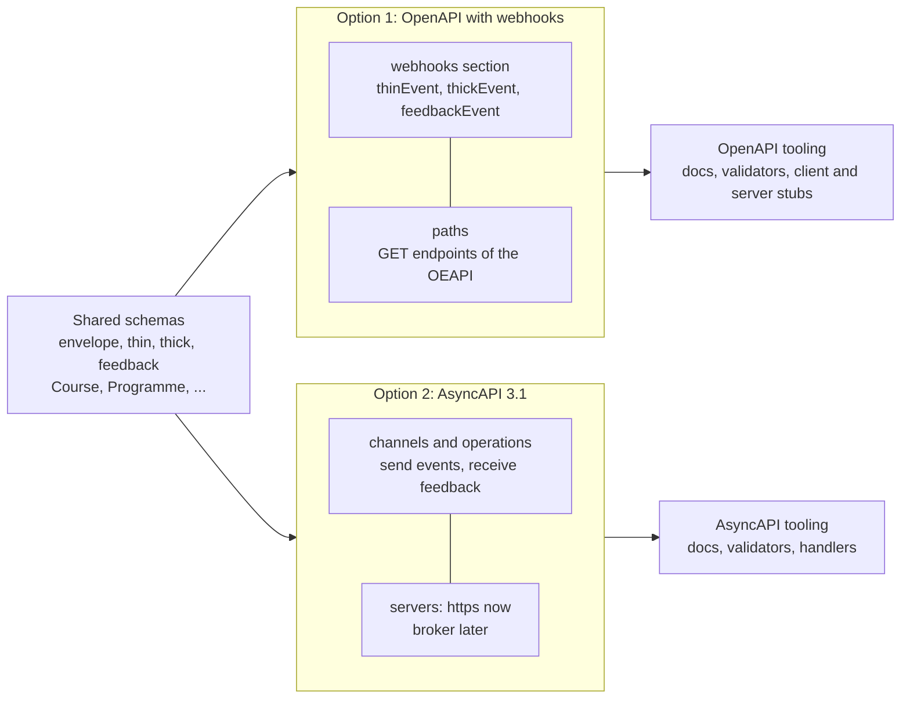
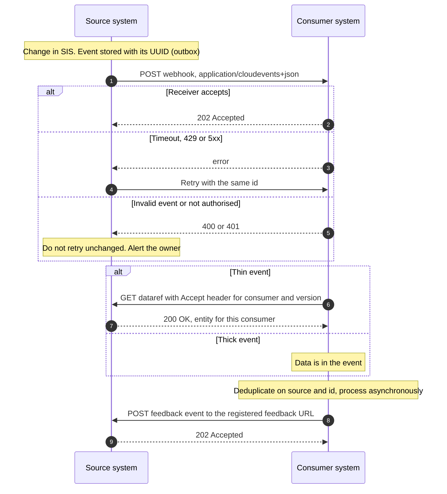
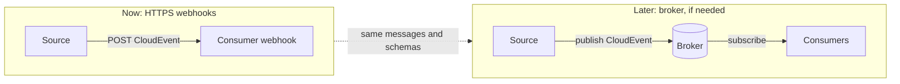
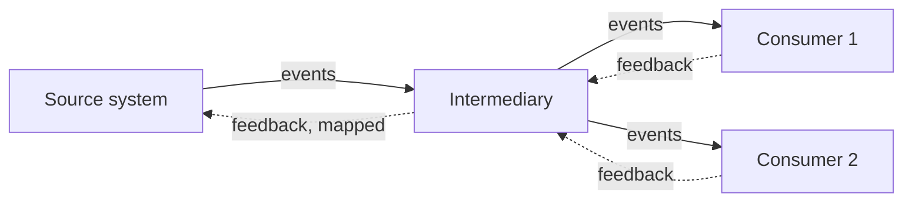

# Delivery and registration of endpoints

This document explains how events travel between a source and a consumer, what has to be agreed
out of band before the first event can be sent, and how the two options of ADR 0007
(OpenAPI webhooks and AsyncAPI) differ in practice.

The short version: **on the wire both options are the same.** In both cases the sender does an HTTP `POST`
of an `application/cloudevents+json` document to a URL the receiver registered. The options differ in the
contract format that describes this, the tooling around it, and the growth path towards brokers.

Terms: *source* is the system that produces the event (SIS, or an intermediary producing events on its behalf).
*Consumer* is the system that receives it (for example RIO or eduXchange, directly or via SURFeduhub).
An intermediary can play both roles, see [Intermediaries](#intermediaries).

## 1. What is agreed out of band

The OEAPI contract does not contain any addresses or credentials. Per consumer a *subscription* is set up.
Both sides keep their half of it.

| Who keeps it | What | Why |
| --- | --- | --- |
| Source | Webhook URL of the consumer | Where to `POST` events |
| Source | Event types the consumer wants (`eu.oeapi.<entities>.<verb>.v<n>`) and whether they are thin or thick | Filtering. The source only sends what was agreed |
| Source | Consumer key and consumer version, and the OEAPI version | Thin events: used as `Accept` header when the consumer fetches the entity. Thick events: decides which projection of the data is sent |
| Source | Token endpoint and scope of the consumer | The source authenticates itself at the consumer (OAuth 2.0 client credentials) |
| Source | Retry policy, rate limit, contact for alerts | Operations |
| Consumer | `source` identifier(s) of the source, per environment (prod, acc, test) | Accepting and deduplicating on `source` + `id` |
| Consumer | Base URL of the OEAPI of the source (for `dataref`, or to build the URL when `dataref` is absent) | Fetching thin events |
| Consumer | Feedback URL of the source | Where to `POST` feedback events |
| Consumer | Client credentials for the OEAPI and the feedback endpoint of the source | Authentication at the source |

Rules of thumb: one subscription per consumer per environment, test and production never share credentials, and the
`source` in the events always matches the environment of the subscription.

## 2. Where the options differ: the contract

Both options describe the same messages. What differs is the artefact the consumer and source developers work with.

| Aspect | Option 1: OpenAPI webhooks | Option 2: AsyncAPI |
| --- | --- | --- |
| Where the contract lives | In the OEAPI OpenAPI document, next to the `GET` endpoints | Separate document that references the shared schemas |
| Request/response and events in one place | Yes | No, two documents (mitigated by sharing the schemas) |
| Subscription and endpoint registration | Out of scope, not in the spec | Out of scope, not in the spec |
| What the wire looks like over HTTPS | `POST` of a CloudEvent | The same |
| Moving to a broker later | Needs an additional specification | Change the server protocol, the messages stay |
| Edukoppeling contract register | Fits the OpenAPI (webhook) part | Fits the AsyncAPI (business data) part |

The two are not mutually exclusive: when the envelope and entity schemas are defined once and referenced by both
(as in the two example files next to the ADR), the "double specification" drawback is limited to the thin
channel/operation layer.

## 3. Runtime flow (identical for both options)

The `202` only says the event was received. The processing result travels in the feedback event, see
[feedback-doc.md](feedback-doc.md).

## 4. Growth path

AsyncAPI keeps the messages and changes the server. HTTP webhooks first, brokers when needed:

With OpenAPI webhooks this step means adding an AsyncAPI (or equivalent) document at that moment. The messages themselves,
and the CloudEvents attributes, do not change in either option.

## 5. Intermediaries

When an intermediary such as SURFeduhub sits between source and consumer, the same mechanism applies per hop. Each hop is
a source for the next one and a consumer for the previous one, with its own subscription, endpoints and credentials.

Whether the intermediary only forwards (the original event and `dataref` stay intact) or produces a new event per
consumer (new `id`, own `source`) decides how feedback can be correlated, see
[feedback-doc.md](feedback-doc.md#correlation-through-an-intermediary).
