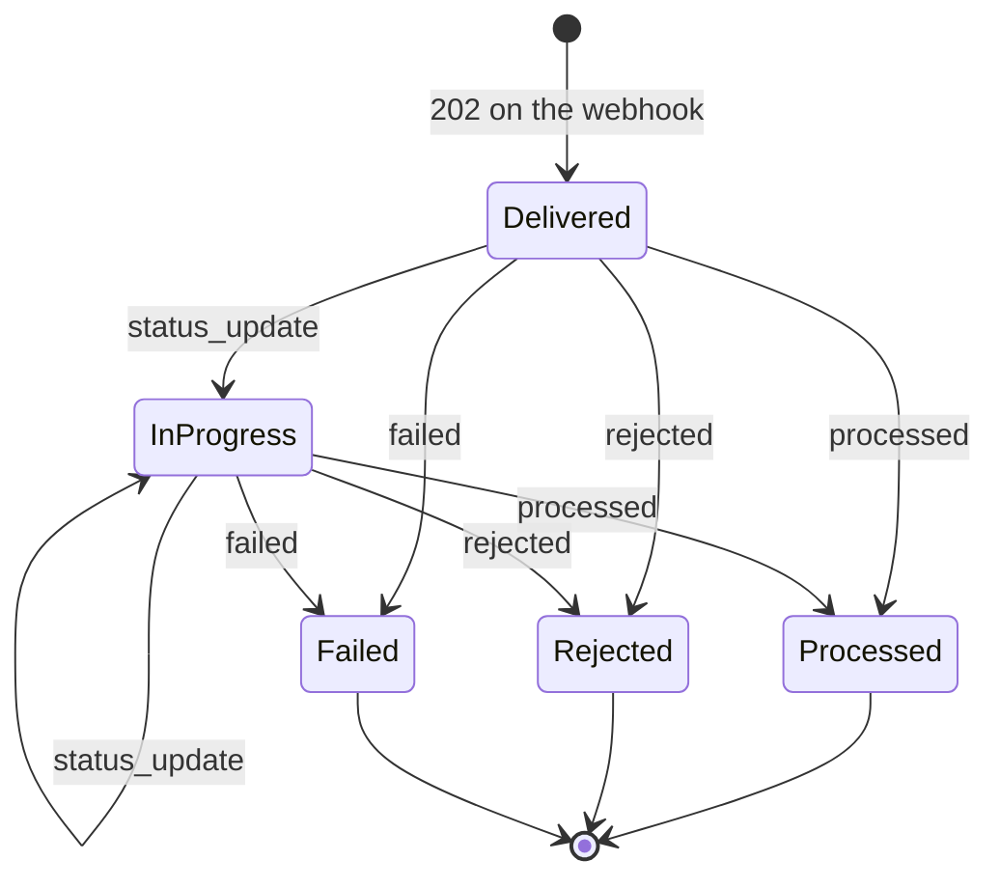

# Feedback Events

Feedback events are a special type of [CloudEvent](cloudevents-doc.md).

## What are Feedback Events?

When regular OEAPI CloudEvents are processed many things may fail or cause warnings (such as unavailability of systems, wrong data format, missing keys, etc). The producer might want to know such 'feedback' as well.

Notice that 'feedback' in this case is not the same as the HTTP status code returned when delivering an event. When delivering an event, a response like `202 Accepted` merely indicates that the event has been received. It does not imply anything about the processing of that event, as that happens asynchronously, including fetching of the data.

## Why feedback matters

Without feedback the source only knows that an event was delivered, not what happened afterwards. With feedback:

- The source sees which entities were **not accepted** and why, and can act: fix the data, or resend.
- Problems become visible per consumer, per entity and per event, instead of surfacing weeks later as missing data.
- Operators of source, consumer and intermediary share one vocabulary for the outcome.
- Repeated rejections for the same reason show structural data-quality issues, which can be taken up with the data owner.

## Requirements

- It must be possible to give feedback on a specific entity (e.g. a programme identified by a UUID).
- It must also be possible to give feedback on a specific event as sent by the producer (by event ID). Only in this way it is possible to identify what the feedback was on the latest update on that specific entity.
- There can be multiple (0...*) feedback responses on a single event.
- It must be possible for the consumer to establish to which endpoint the feedback should be sent. This is part of the subscription, see [delivery-and-registration.md](delivery-and-registration.md).
- Differentiation for different feedback types (the `data.type` value, lowercase in the message):
  * `status_update`: a non-final state that tells something about this event being processed. These types of feedback are of a technical nature.
  * `rejected`: the event was rejected as it did not comply with technical or functional requirements.
  * `failed`: the event failed to be processed, but it was not rejected. This usually happens after long unavailability of dependent systems. Retrying the same event might work.
  * `processed`: the event was successfully processed. The feedback MAY contain non-critical warnings.
- `rejected`, `failed` and `processed` are final for that event. `status_update` is not.
- The feedback MAY contain an array of messages. It MUST contain at least one message when the type is `status_update` or `rejected`. In that case, the first message MUST be the major reason of the status update or the rejection.
- Each message can be of a type: `critical`, `warning`, `tracing`. The `critical` message type MUST only occur in `failed` or `rejected` feedback.
- Each message can be translated in multiple languages.
- Messages MUST NOT contain personal data. Refer to the entity through `subject` and describe the problem in general terms (for example "email address has an invalid format", not the address itself).

## Specification

The CloudEvents attributes of a feedback event:

| Attribute         | Content                                                                | Required | Example                                          |
| ----------------- | ---------------------------------------------------------------------- | -------- | ------------------------------------------------ |
| specversion       | Always 1.0                                                             | yes      | 1.0                                              |
| id                | UUID of this feedback event, unique                                    | yes      | e96d9dd2-58b3-45e1-8d91-30bd31874bf9             |
| type              | OEAPI entity type suffixed with `.feedbackprovided` and a version      | yes      | eu.oeapi.programmes.feedbackprovided.v1          |
| source            | URI of the system generating the feedback (same format as for events)  | yes      | https://sampleregistry.eu/prod                   |
| subject           | UUID of the entity this feedback is about                              | yes      | 7c9e6679-7425-40de-944b-e07fc1f90ae7             |
| time              | RFC 3339 in UTC with milliseconds                                      | yes      | 2026-10-06T13:00:05.250Z                         |
| payloadtype       | Always `thick`                                                         | yes      | thick                                            |
| correlationid     | `id` of the event that this feedback applies to                        | no (1)   | 0f8fad5b-d9cb-469f-a165-70867728950e             |
| correlationsource | `source` of the event that this feedback applies to                    | yes, if `correlationid` is present | https://example-university.fr/sis/prod |

(1) `correlationid` is not required, because the feedback does not have to apply to a specific event. For example, when a client is simply performing a GET on a programme, it may encounter an error or feedback may originate during the subsequent processing of that data. In that case there is no original event id, but feedback may still be provided for that specific entity (type + subject). If the feedback does apply to an original event, `correlationid` and `correlationsource` MUST both be included: `id` is only unique within a `source`, so the pair identifies the event.

The `data` of a feedback event:

| Attribute | Content                                                                  | Required |
| --------- | ------------------------------------------------------------------------ | -------- |
| type      | `status_update`, `rejected`, `failed` or `processed`                     | yes      |
| messages  | Array of messages, see requirements above                                | depends  |

Each message has a `type` (`critical`, `warning`, `tracing`) and a `content` array of `{ language, value }` entries (the OEAPI `LanguageTypedString`).

## Sample message

```json
{
  "specversion": "1.0",
  "id": "e96d9dd2-58b3-45e1-8d91-30bd31874bf9",
  "type": "eu.oeapi.programmes.feedbackprovided.v1",
  "source": "https://sampleregistry.eu/prod",
  "subject": "7c9e6679-7425-40de-944b-e07fc1f90ae7",
  "correlationid": "0f8fad5b-d9cb-469f-a165-70867728950e",
  "correlationsource": "https://example-university.fr/sis/prod",
  "time": "2026-10-06T13:00:05.250Z",
  "payloadtype": "thick",
  "data": {
    "type": "rejected",
    "messages": [
      {
        "type": "critical",
        "content": [
          { "language": "en-GB", "value": "This programme is missing a description" },
          { "language": "nl", "value": "Deze opleiding mist een omschrijving" }
        ]
      },
      {
        "type": "warning",
        "content": [
          { "language": "en-GB", "value": "First enrollment starts on 01-01-2036." }
        ]
      }
    ]
  }
}
```

## Life cycle of an event



`Delivered` is known to the source from the webhook response. Everything after that comes from feedback events. The latest
feedback (by `time`) for an event wins. An event without feedback for longer than the agreed period is treated as unknown
and followed up like a failure.

## What the source does with feedback

| Feedback | Meaning | Action at the source |
| --- | --- | --- |
| `processed` | Done. May contain warnings | Close. Review warnings now and then for data quality |
| `status_update` | Technical progress | Informational. Show in monitoring |
| `failed` | Consumer could not process, but did not reject | Resend the same event (same `id`, idempotent) once the consumer is available again, or send a new event if the entity changed meanwhile |
| `rejected` | The data did not comply | Do not resend unchanged. Fix the data (or the mapping), then send a new event with a new `id` |

Two further rules keep this manageable:

- A resend of a `failed` event uses the same `id` and `source`. The consumer deduplicates, so a consumer that did process it only answers `processed` again.
- A corrected entity is a new occurrence and gets a new `id`. Feedback on the old event stays as history.

Typical uses at the source: a dashboard of open `rejected` and `failed` events per consumer, alerts after a threshold, and a
periodic report of the most frequent critical messages as input for data improvement.

## Registering the feedback endpoint

The feedback endpoint is part of the subscription and is registered out of band, like the webhook of the consumer
(see [delivery-and-registration.md](delivery-and-registration.md)). In the contract it is the `feedbackEvent` webhook
(OpenAPI) or the `receiveFeedback` operation (AsyncAPI). It flows in the opposite direction of the events: the consumer is
the sender, the source (or intermediary) is the receiver. The same security rules apply: TLS, OAuth 2.0 client credentials,
and answering `202` on acceptance.

## Correlation through an intermediary

`correlationid` and `correlationsource` point at the event the consumer received.

- **Intermediary forwards the event unchanged:** the consumer received the original event, so the correlation points at the
  source's event and the feedback can go to the source directly or via the intermediary.
- **Intermediary produces a new event per consumer (new `id`, own `source`):** the consumer's correlation points at the
  intermediary's event. The intermediary must keep the mapping to the original event and either pass the feedback on with the
  original correlation, or let the source retrieve it. This is one of the open points of the intermediary scenarios.

## Privacy and volume

- Feedback messages are context for people and monitoring. They MUST NOT carry personal data (see requirements).
- Feedback events are small and SHOULD be sent per final result, not per tracing step, unless the subscription asks for
  `status_update` and `tracing` messages.
- Retention of feedback follows the retention of the event log of the receiver.
